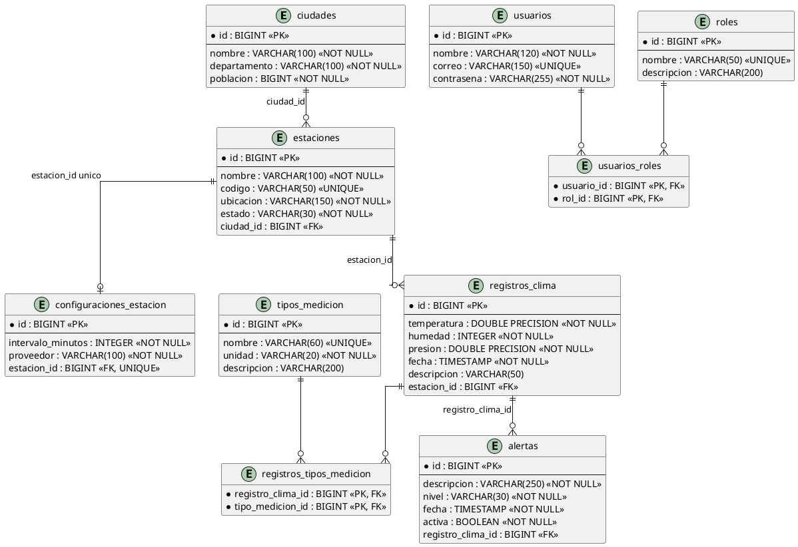
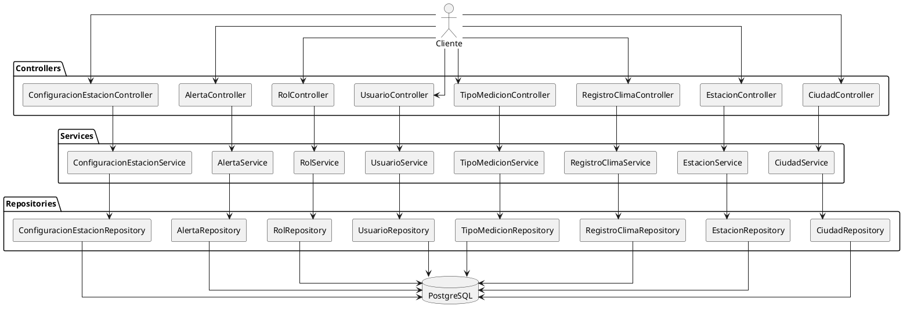

# Entrega del taller complementario

## Sistema de gestion meteorologica

Este documento explica la solucion construida sobre el proyecto `clima`, relaciona cada requisito del taller con el codigo existente y deja preparados los materiales que deben presentarse como evidencia.

La aplicacion utiliza Spring Boot, Spring Web MVC, Spring Data JPA, Hibernate, Maven y PostgreSQL. La API se ejecuta por defecto en `http://localhost:8081`.

## 1. Estado general de la solucion

| Requisito | Estado | Ubicacion principal |
|---|---|---|
| Entidades JPA | Implementado | `src/main/java/edu/ucaldas/clima/model` |
| Repositorios JPA | Implementado | `src/main/java/edu/ucaldas/clima/persistance` |
| Relaciones 1:1, 1:N y N:M | Implementado | Entidades del modelo |
| CRUD de ciudades | Implementado | `CiudadController`, `CiudadService` |
| CRUD de estaciones | Implementado | `EstacionController`, `EstacionService` |
| CRUD de mediciones | Implementado | `RegistroClimaController`, `RegistroClimaService` |
| CRUD de tipos de medicion | Implementado | `TipoMedicionController`, `TipoMedicionService` |
| Creacion y consulta de usuarios | Parcialmente implementado | `UsuarioController`, `UsuarioService` |
| Creacion y consulta de roles | Parcialmente implementado | `RolController`, `RolService` |
| Creacion y consulta de alertas | Parcialmente implementado | `AlertaController`, `AlertaService` |
| Configuracion 1:1 de estaciones | Parcialmente implementado | `ConfiguracionEstacionController`, `ConfiguracionEstacionService` |
| Validaciones de entrada | Implementado | DTOs con Bean Validation |
| Manejo de errores | Implementado | `GlobalExceptionHandler` |
| Consultas personalizadas | Implementado | Repositorios JPA |
| Script SQL | Implementado | `database/schema.sql` |
| Diagrama ER | Codigo PlantUML incluido abajo | Este documento |
| Coleccion Postman | Parcialmente implementado | `postman/Clima.postman_collection.json` |
| Pruebas de contexto | Implementado | `ClimaApplicationTests` |
| Pruebas especificas | Pendiente | Deben agregarse |
| Hash y autenticacion | Pendiente | Requiere Spring Security |

## 2. Arquitectura y flujo de la aplicacion

La aplicacion esta organizada por capas:

```text
Cliente HTTP
    |
    v
Controller REST
    |
    v
Service
    |
    v
Repository Spring Data JPA
    |
    v
Hibernate / EntityManager
    |
    v
PostgreSQL
```

### Controladores

Reciben peticiones HTTP, validan el cuerpo con `@Valid`, delegan la operacion al servicio y devuelven entidades o listas serializadas como JSON.

### Servicios

Contienen la logica de aplicacion. Resuelven relaciones mediante IDs, verifican que las entidades relacionadas existan y ejecutan las operaciones a traves de los repositorios.

### Repositorios

Extienden `JpaRepository`, por lo que heredan operaciones como `findAll`, `findById`, `save` y `delete`. Tambien declaran consultas derivadas y una consulta JPQL para el promedio de temperatura.

### Entidades

Representan tablas relacionales y contienen las anotaciones JPA que definen claves, restricciones, claves foraneas y relaciones.

## 3. Diagrama entidad-relacion en PlantUML

El siguiente codigo puede copiarse en PlantUML, PlantUML Server, la extension PlantUML de VS Code o una herramienta compatible para generar PNG, SVG o PDF.



### Lectura de cardinalidades

- Una ciudad puede tener cero o muchas estaciones. Cada estacion pertenece obligatoriamente a una ciudad.
- Una estacion puede capturar cero o muchas mediciones. Cada medicion pertenece obligatoriamente a una estacion.
- Una estacion puede tener cero o una configuracion. La columna `estacion_id` es unica en `configuraciones_estacion`.
- Una medicion puede generar cero o muchas alertas. Cada alerta pertenece a un registro climatico.
- Un registro climatico puede asociarse con varios tipos de medicion y un tipo puede clasificar varios registros. Esta relacion se resuelve con `registros_tipos_medicion`.
- Un usuario puede tener varios roles y un rol puede pertenecer a varios usuarios. Esta relacion se resuelve con `usuarios_roles`.

## 4. Diagrama de componentes en PlantUML

Este segundo diagrama muestra como se conectan las capas del codigo.



## 5. Justificacion de las entidades y relaciones JPA

### Ciudad y Estacion: `@OneToMany` / `@ManyToOne`

`Ciudad` es el lugar geografico donde operan las estaciones. La entidad `Estacion` es la propietaria de la relacion porque contiene la clave foranea `ciudad_id` mediante `@JoinColumn`. En la entidad `Ciudad`, `mappedBy = "ciudad"` indica que la coleccion es el lado inverso y que la FK no se duplica.

Se usa `cascade = CascadeType.ALL` y `orphanRemoval = true` en la coleccion de estaciones. Esto expresa que una estacion depende del ciclo de vida de su ciudad dentro de este ejercicio. Antes de usar eliminaciones en produccion debe confirmarse si se desea borrar historicos meteorologicos junto con una ciudad.

### Estacion y RegistroClima: `@OneToMany` / `@ManyToOne`

Una estacion produce muchas mediciones. La FK `estacion_id` esta en `registros_clima`, por lo que `RegistroClima` es el lado propietario. La coleccion inversa se marca con `mappedBy`.

La medicion exige una estacion (`optional = false`, `nullable = false`) porque un registro sin origen no tendria significado meteorologico.

### Estacion y ConfiguracionEstacion: `@OneToOne`

La configuracion es una extension de la estacion. La FK en `configuraciones_estacion` tiene restriccion unica, garantizando que una estacion no tenga dos configuraciones simultaneas.

### Usuario y Rol: `@ManyToMany` / `@JoinTable`

Un usuario puede tener varios roles, como `ADMIN` o `CONSULTA`, y un rol puede ser asignado a muchos usuarios. Por eso se crea la tabla intermedia `usuarios_roles`, cuya clave primaria compuesta evita asignaciones duplicadas.

La entidad `Usuario` es el lado propietario porque declara `@JoinTable`. `Rol` usa `mappedBy = "roles"` para representar el lado inverso.

### RegistroClima y TipoMedicion: `@ManyToMany` / `@JoinTable`

El taller pide implementar esta relacion como ejercicio de mapeo N:M. La tabla `registros_tipos_medicion` permite asociar una medicion con varios tipos del catalogo.

En un sistema productivo, una medicion normalmente debe tener una variable, unidad y valor propios. Una alternativa mas normalizada seria:

```text
ValorMedicion
- id
- registro_clima_id
- tipo_medicion_id
- valor
```

Esta alternativa permite guardar temperatura, humedad, presion u otra variable como filas independientes. La implementacion actual conserva el modelo N:M solicitado por el taller y mantiene temperatura, humedad y presion como columnas de `RegistroClima`.

### RegistroClima y Alerta: `@OneToMany` / `@ManyToOne`

Una condicion detectada en una medicion puede producir varias alertas. La alerta conserva `registro_clima_id`, fecha, nivel y estado activo.

## 6. Justificacion de restricciones y serializacion

- `@Id` identifica cada fila.
- `@GeneratedValue(strategy = GenerationType.IDENTITY)` delega la generacion del ID a PostgreSQL mediante columnas autoincrementales.
- `@Column(nullable = false)` evita valores nulos en campos obligatorios.
- `@Column(unique = true)` se aplica a codigos, correos, roles y tipos que no deben repetirse.
- `@Column(length = ...)` limita la longitud esperada de los textos.
- Los DTOs aplican validaciones antes de llegar al servicio: humedad entre 0 y 100, poblacion positiva, correo valido y textos obligatorios.
- `@JsonIgnore` evita serializar colecciones inversas y previene ciclos como ciudad-estacion-ciudad.
- `@JsonProperty(access = WRITE_ONLY)` permite recibir `contrasena` al crear un usuario, pero evita devolverla en respuestas JSON.
- `open-in-view=false` evita consultas JPA automáticas durante la serializacion de la respuesta web.

## 7. Conexion con PostgreSQL

### Crear la base de datos

Desde pgAdmin o `psql`:

```sql
CREATE DATABASE clima;
```

La base debe existir, pero las tablas pueden crearse de dos formas:

1. Con Hibernate, usando `JPA_DDL_AUTO=update`.
2. Ejecutando manualmente `database/schema.sql` sobre una base vacia.

No se debe ejecutar repetidamente el script completo sobre una base que ya tiene las tablas sin revisar primero el estado del esquema.

### Variables de entorno en PowerShell

Las variables deben configurarse en la misma terminal que ejecuta Maven:

```powershell
$env:DB_URL = "jdbc:postgresql://localhost:5432/clima"
$env:DB_USERNAME = "postgres"
$env:DB_PASSWORD = "admin"
$env:JPA_DDL_AUTO = "update"
$env:JPA_SHOW_SQL = "false"
.\mvnw.cmd spring-boot:run
```

La contraseña no debe escribirse en `application.properties` ni subirse al repositorio. Las variables de PowerShell duran solo mientras esa terminal permanece abierta.

### Configuracion utilizada por Spring

```properties
spring.datasource.url=${DB_URL:jdbc:postgresql://localhost:5432/clima}
spring.datasource.username=${DB_USERNAME:postgres}
spring.datasource.password=${DB_PASSWORD:}
spring.jpa.hibernate.ddl-auto=${JPA_DDL_AUTO:update}
spring.jpa.show-sql=${JPA_SHOW_SQL:false}
spring.jpa.open-in-view=false
```

### Comprobacion de conexion

Cuando la aplicacion arranca correctamente, el log debe mostrar una conexion PostgreSQL y la base `clima/public`. Tambien puede comprobarse con:

```powershell
Invoke-WebRequest http://localhost:8081/api/ciudades
```

La respuesta esperada para una base sin datos es HTTP `200` con `[]`.

## 8. API REST documentada

Todos los cuerpos JSON deben enviarse con:

```http
Content-Type: application/json
```

Las respuestas de creacion utilizan HTTP `201 Created`, las eliminaciones HTTP `204 No Content`, las consultas exitosas HTTP `200 OK`, los datos invalidos HTTP `400 Bad Request`, los recursos inexistentes HTTP `404 Not Found` y las restricciones de base de datos HTTP `409 Conflict`.

### Endpoint raiz

```http
GET /
```

Respuesta:

```json
{
  "estado": "activa",
  "aplicacion": "clima",
  "api": "/api",
  "documentacion": "README.md"
}
```

### Ciudades

#### Listar ciudades

```http
GET /api/ciudades
```

#### Consultar una ciudad

```http
GET /api/ciudades/{id}
```

#### Crear una ciudad

```http
POST /api/ciudades
```

```json
{
  "nombre": "Manizales",
  "departamento": "Caldas",
  "poblacion": 454000
}
```

#### Actualizar una ciudad

```http
PUT /api/ciudades/{id}
```

Usa el mismo cuerpo del endpoint de creacion.

#### Eliminar una ciudad

```http
DELETE /api/ciudades/{id}
```

La eliminacion puede propagarse a estaciones y entidades dependientes por la configuracion `cascade` y `orphanRemoval`. Debe probarse con cuidado en una base que tenga datos importantes.

### Estaciones

#### Listar estaciones

```http
GET /api/estaciones
```

#### Consultar una estacion

```http
GET /api/estaciones/{id}
```

#### Consultar estaciones de una ciudad

```http
GET /api/estaciones/ciudad/{id}
```

#### Crear una estacion

```http
POST /api/estaciones
```

```json
{
  "nombre": "Estacion Centro",
  "codigo": "MAN-CEN-01",
  "ubicacion": "Centro de Manizales",
  "estado": "ACTIVA",
  "ciudadId": 1
}
```

El `ciudadId` se resuelve en `EstacionService`. Si no existe, la API responde `404`.

#### Actualizar una estacion

```http
PUT /api/estaciones/{id}
```

#### Eliminar una estacion

```http
DELETE /api/estaciones/{id}
```

### Registros climaticos

#### Listar registros

```http
GET /api/registros-clima
```

#### Consultar un registro

```http
GET /api/registros-clima/{id}
```

#### Consultar registros de una estacion

```http
GET /api/registros-clima/estacion/{id}
```

#### Crear un registro

```http
POST /api/registros-clima
```

```json
{
  "temperatura": 31.4,
  "humedad": 68,
  "presion": 1012.8,
  "fecha": "2026-10-30T14:30:00",
  "descripcion": "Medicion de la tarde",
  "estacionId": 1,
  "tiposMedicionIds": [1, 2]
}
```

`estacionId` debe corresponder a una estacion existente. Los IDs de `tiposMedicionIds` se buscan en el catalogo y se insertan en `registros_tipos_medicion`.

#### Actualizar un registro

```http
PUT /api/registros-clima/{id}
```

#### Eliminar un registro

```http
DELETE /api/registros-clima/{id}
```

#### Temperaturas superiores a un valor

```http
GET /api/registros-clima/temperatura-superior?valor=30
```

La consulta derivada utilizada es `findByTemperaturaGreaterThan`.

#### Promedio de temperatura por ciudad

```http
GET /api/registros-clima/promedio/ciudad/{id}
```

La consulta JPQL recorre `RegistroClima -> Estacion -> Ciudad`:

```java
@Query("SELECT AVG(r.temperatura) FROM RegistroClima r WHERE r.estacion.ciudad.id = :ciudadId")
Double obtenerTemperaturaPromedio(@Param("ciudadId") Long ciudadId);
```

### Tipos de medicion

#### Listar tipos

```http
GET /api/tipos-medicion
```

#### Consultar un tipo

```http
GET /api/tipos-medicion/{id}
```

#### Crear un tipo

```http
POST /api/tipos-medicion
```

```json
{
  "nombre": "Temperatura",
  "unidad": "C",
  "descripcion": "Temperatura del aire"
}
```

#### Actualizar o eliminar

```http
PUT /api/tipos-medicion/{id}
DELETE /api/tipos-medicion/{id}
```

### Usuarios

#### Listar o consultar usuarios

```http
GET /api/usuarios
GET /api/usuarios/{id}
```

#### Crear usuario

```http
POST /api/usuarios
```

```json
{
  "nombre": "Ana Perez",
  "correo": "ana@example.com",
  "contrasena": "temporal"
}
```

La implementacion actual guarda la contrasena recibida como texto y solo evita devolverla en JSON. Esto es suficiente para demostrar el modelo, pero no es aceptable para produccion. La seccion de seguridad explica el cambio necesario.

#### Asignar un rol

```http
POST /api/usuarios/{id}/roles/{rolId}
```

No necesita cuerpo. El servicio evita insertar dos veces el mismo rol en la coleccion del usuario.

#### Consultar usuarios por rol

```http
GET /api/usuarios/rol/{nombre}
```

Ejemplo:

```http
GET /api/usuarios/rol/ADMIN
```

### Roles

#### Listar o consultar roles

```http
GET /api/roles
GET /api/roles/{id}
```

#### Crear rol

```http
POST /api/roles
```

```json
{
  "nombre": "ADMIN",
  "descripcion": "Administrador del sistema"
}
```

### Alertas

#### Listar o consultar alertas

```http
GET /api/alertas
GET /api/alertas/{id}
```

#### Crear alerta

```http
POST /api/alertas
```

```json
{
  "descripcion": "Temperatura superior al umbral",
  "nivel": "ALTA",
  "fecha": "2026-10-30T15:00:00",
  "activa": true,
  "registroClimaId": 1
}
```

#### Consultar por nivel

```http
GET /api/alertas/nivel/{nivel}
```

#### Consultar alertas activas de una ciudad

```http
GET /api/alertas/activas/ciudad/{id}
```

La consulta derivada atraviesa `Alerta -> RegistroClima -> Estacion -> Ciudad` y filtra `activa = true`.

### Configuracion de estacion

#### Listar configuraciones

```http
GET /api/configuraciones-estacion
```

#### Crear configuracion

```http
POST /api/configuraciones-estacion
```

```json
{
  "intervaloMinutos": 15,
  "proveedor": "Proveedor meteorologico",
  "estacionId": 1
}
```

La columna `estacion_id` es unica, por lo que una estacion no puede recibir dos configuraciones.

## 9. Validacion y manejo de errores

Los DTOs protegen la entrada antes de ejecutar la logica de negocio. Algunos ejemplos:

- `@NotBlank`: nombre, departamento, codigo, descripcion y otros textos obligatorios.
- `@NotNull`: IDs, fechas y valores necesarios.
- `@Positive`: poblacion e intervalo de configuracion.
- `@Min(0)` y `@Max(100)`: humedad.
- `@Email`: correo de usuario.
- `@Size`: limites de textos.

`GlobalExceptionHandler` transforma errores frecuentes en respuestas JSON con fecha, estado, tipo y mensaje.

Ejemplo de recurso inexistente:

```json
{
  "fecha": "2026-10-30T15:00:00",
  "estado": 404,
  "error": "Not Found",
  "mensaje": "Ciudad no encontrada: 99"
}
```

## 10. Evidencias de Postman

La coleccion base esta en `postman/Clima.postman_collection.json`. Para completar la evidencia del taller:

1. Iniciar PostgreSQL y la aplicacion.
2. Importar la coleccion en Postman.
3. Configurar `baseUrl` como `http://localhost:8081`.
4. Ejecutar primero la creacion de ciudad y guardar el ID devuelto.
5. Actualizar la variable `ciudadId`.
6. Crear una estacion y guardar `estacionId`.
7. Crear tipos de medicion y guardar sus IDs.
8. Crear una medicion y guardar `registroId`.
9. Crear un rol y un usuario, y guardar `rolId` y `usuarioId`.
10. Ejecutar la asignacion del rol.
11. Crear una alerta.
12. Ejecutar las consultas relacionales y personalizadas.
13. Tomar capturas donde se vea metodo, URL, cuerpo, estado HTTP y respuesta.

Las capturas recomendadas son:

| Evidencia | Peticion |
|---|---|
| Creacion de ciudad | `POST /api/ciudades` con `201` |
| Consulta relacional | `GET /api/estaciones/ciudad/{id}` |
| Creacion de medicion | `POST /api/registros-clima` con `201` |
| Consulta por estacion | `GET /api/registros-clima/estacion/{id}` |
| Consulta personalizada | temperatura superior y promedio |
| Usuarios y roles | asignacion y consulta por rol |
| Alertas | filtrado por nivel y ciudad |
| Validacion | enviar humedad mayor que 100 y capturar `400` |
| No encontrado | consultar un ID inexistente y capturar `404` |

La coleccion actual es una base de demostracion. Para una entrega completa deben agregarse a Postman las peticiones de crear usuario, crear rol, crear tipo, crear alerta y crear configuracion, usando los cuerpos de este documento.

## 11. Evidencias de PostgreSQL

En pgAdmin se debe mostrar la base `clima`, el esquema `public` y las tablas creadas. Tambien se pueden ejecutar estas consultas para generar evidencia:

```sql
SELECT table_name
FROM information_schema.tables
WHERE table_schema = 'public'
ORDER BY table_name;
```

```sql
SELECT * FROM ciudades;
SELECT * FROM estaciones;
SELECT * FROM configuraciones_estacion;
SELECT * FROM registros_clima;
SELECT * FROM tipos_medicion;
SELECT * FROM registros_tipos_medicion;
SELECT * FROM usuarios;
SELECT * FROM roles;
SELECT * FROM usuarios_roles;
SELECT * FROM alertas;
```

Para evidenciar claves foraneas:

```sql
SELECT
    tc.table_name,
    kcu.column_name,
    ccu.table_name AS tabla_referenciada,
    ccu.column_name AS columna_referenciada
FROM information_schema.table_constraints AS tc
JOIN information_schema.key_column_usage AS kcu
  ON tc.constraint_name = kcu.constraint_name
 AND tc.table_schema = kcu.table_schema
JOIN information_schema.constraint_column_usage AS ccu
  ON ccu.constraint_name = tc.constraint_name
 AND ccu.table_schema = tc.table_schema
WHERE tc.constraint_type = 'FOREIGN KEY'
  AND tc.table_schema = 'public'
ORDER BY tc.table_name, kcu.column_name;
```

El entregable debe incluir capturas de:

- Tablas del esquema.
- Filas de ejemplo en las tablas principales.
- Tabla intermedia `usuarios_roles`.
- Tabla intermedia `registros_tipos_medicion`.
- Claves foraneas y restricciones unicas.

## 12. Seguridad: hash y autenticacion

### Estado actual

La entidad `Usuario` tiene un campo `contrasena`, pero no se ha agregado Spring Security. La contrasena se guarda actualmente tal como llega en el JSON. `@JsonProperty(access = WRITE_ONLY)` solo evita exponerla en respuestas; no la protege en la base de datos.

Por tanto, el requisito de hash y autenticacion queda pendiente si el docente lo exige.

### Implementacion minima recomendada

Agregar al `pom.xml`:

```xml
<dependency>
    <groupId>org.springframework.boot</groupId>
    <artifactId>spring-boot-starter-security</artifactId>
</dependency>
```

Crear un bean para codificar contrasenas:

```java
@Bean
public PasswordEncoder passwordEncoder() {
    return new BCryptPasswordEncoder();
}
```

Inyectar `PasswordEncoder` en `UsuarioService` y codificar antes de guardar:

```java
public Usuario crear(UsuarioDTO dto) {
    String hash = passwordEncoder.encode(dto.getContrasena());
    return repository.save(new Usuario(dto.getNombre(), dto.getCorreo(), hash));
}
```

Para autenticacion real tambien se requiere:

- `UserDetailsService` que busque por correo.
- `SecurityFilterChain`.
- Endpoint de login.
- Sesion o tokens JWT.
- Reglas de autorizacion por rol.
- No devolver nunca el hash.
- Pruebas de login, credenciales incorrectas y acceso por rol.

No se debe presentar la implementacion actual como autenticacion terminada.

## 13. Pruebas especificas pendientes y propuesta

La prueba actual de `ClimaApplicationTests` confirma que el contexto inicia usando H2 y el perfil `test`. Para cubrir el taller completamente se recomienda agregar:

### Pruebas de repositorio

- Guardar y consultar una ciudad.
- Buscar estaciones mediante `findByCiudadId`.
- Buscar registros mediante `findByEstacionId`.
- Verificar temperaturas superiores a 30.
- Verificar el promedio por ciudad.
- Consultar usuarios por rol.
- Consultar alertas por nivel y ciudad.

Usar `@DataJpaTest` y H2.

### Pruebas de servicio

- Crear una entidad con una FK valida.
- Rechazar una FK inexistente con `RecursoNoEncontradoException`.
- Actualizar y eliminar una entidad.
- Asignar un rol sin duplicarlo.
- Resolver los tipos de medicion de una medicion.

Usar Mockito para simular los repositorios.

### Pruebas de controlador

- Verificar rutas y codigos HTTP.
- Verificar que `POST` devuelve `201`.
- Verificar que `DELETE` devuelve `204`.
- Enviar un DTO invalido y verificar `400`.
- Consultar un ID inexistente y verificar `404`.

Usar `@WebMvcTest` y `MockMvc`.

### Pruebas de integracion

- Levantar el contexto con H2.
- Crear una ciudad, una estacion, una medicion y una alerta.
- Ejecutar las consultas relacionales.
- Verificar que las tablas intermedias se llenen.

## 14. CRUD que falta completar si el docente lo exige

El taller pide administrar usuarios, roles, alertas y configuraciones, pero el minimo de endpoints entregado para esos recursos no incluye todas las operaciones CRUD.

### Usuarios

Implementado:

- Listar.
- Consultar por ID.
- Crear.
- Asignar rol.
- Consultar por rol.

Pendiente si se exige CRUD completo:

- `PUT /api/usuarios/{id}`.
- `DELETE /api/usuarios/{id}`.

### Roles

Implementado:

- Listar.
- Consultar por ID.
- Crear.

Pendiente:

- `PUT /api/roles/{id}`.
- `DELETE /api/roles/{id}`.

### Alertas

Implementado:

- Listar.
- Consultar por ID.
- Crear.
- Consultar por nivel.
- Consultar activas por ciudad.

Pendiente:

- `PUT /api/alertas/{id}`.
- `DELETE /api/alertas/{id}`.
- Una operacion especifica para cerrar o desactivar una alerta, por ejemplo `PATCH /api/alertas/{id}/estado`.

### Configuraciones

Implementado:

- Listar.
- Crear.

Pendiente:

- Consultar por ID.
- Actualizar.
- Eliminar.

## 15. Entregables que deben entregarse fuera del codigo

Para presentar el taller, preparar una carpeta o informe con:

1. Este documento Markdown convertido a PDF si el docente lo solicita.
2. Imagen o PDF generado desde el codigo PlantUML del diagrama ER.
3. Imagen del diagrama de componentes o arquitectura.
4. `database/schema.sql`.
5. Codigo fuente de entidades, repositorios, servicios y controladores.
6. Coleccion Postman con respuestas o capturas de ejecucion.
7. Capturas de PostgreSQL mostrando tablas, restricciones y datos.
8. Resultado de `mvnw.cmd test`.
9. Explicacion oral o escrita de cardinalidades, `mappedBy`, `cascade`, `fetch`, `orphanRemoval`, `@JoinColumn`, `@JoinTable` y `@Query`.
10. Si se exige seguridad, implementacion y evidencia de BCrypt, login y autorizacion por roles.

## 16. Comandos de verificacion

```powershell
.\mvnw.cmd clean test
```

```powershell
git diff --check
```

```powershell
$env:DB_USERNAME = "postgres"
$env:DB_PASSWORD = "admin"
$env:JPA_DDL_AUTO = "update"
$env:JPA_SHOW_SQL = "false"
.\mvnw.cmd spring-boot:run
```

Comprobacion HTTP:

```powershell
Invoke-WebRequest http://localhost:8081/
Invoke-WebRequest http://localhost:8081/api/ciudades
```

Si aparece `Port 8081 was already in use`, no se debe iniciar una segunda instancia. Se puede consultar el proceso con:

```powershell
Get-NetTCPConnection -LocalPort 8081 -State Listen
```

## Conclusiones

La parte central del taller ya esta implementada: modelo relacional, entidades JPA, relaciones, repositorios, servicios, controladores, validaciones y consultas personalizadas. El esquema y la documentacion permiten generar los diagramas y demostrar la conexion con PostgreSQL.

Los pendientes que no son solo documentacion son seguridad con Spring Security, hash de contrasenas, pruebas especificas y CRUD completo para los recursos que el docente decida evaluar con el mismo nivel de exigencia. Es importante distinguir estos pendientes en la sustentacion para no afirmar que estan implementados cuando aun requieren codigo adicional.
