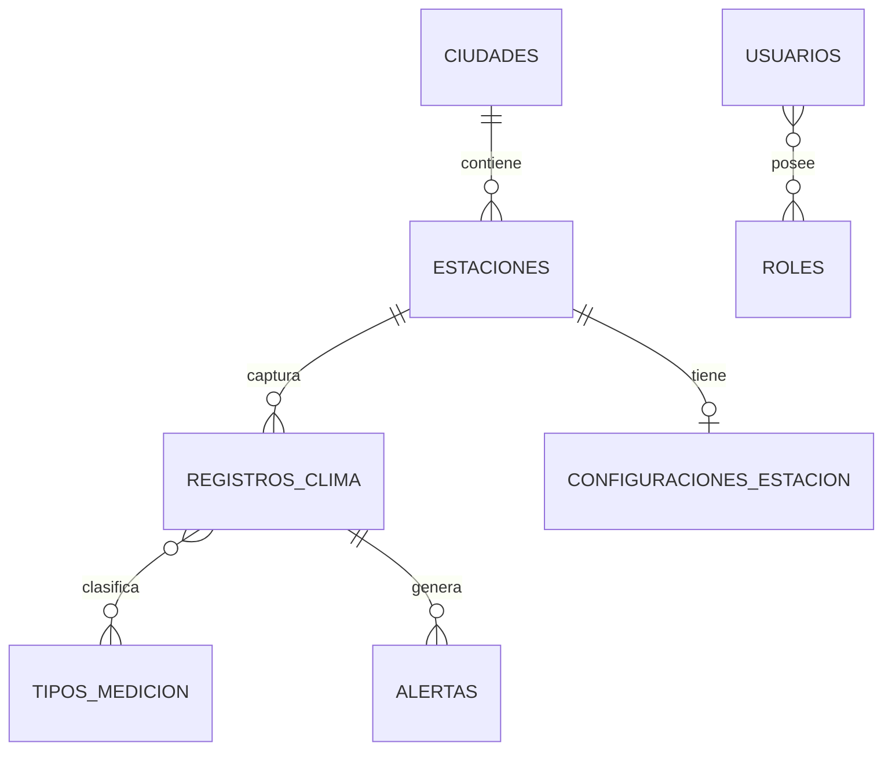

# Modelo relacional

## Decisiones

- `Ciudad` es la entidad padre de `Estacion`; la FK `ciudad_id` vive en `estaciones`.
- `Estacion` es la entidad padre de `RegistroClima`; la FK `estacion_id` vive en `registros_clima`.
- `ConfiguracionEstacion` usa una FK unica a `Estacion`, por lo que la relacion es 1:1.
- `Usuario` y `Rol` usan `usuarios_roles` como tabla intermedia N:M.
- `RegistroClima` y `TipoMedicion` usan `registros_tipos_medicion` como tabla intermedia N:M porque es el mapeo solicitado por el taller.
- En un sistema real, una medicion puede modelarse mejor como una entidad con valor y tipo, por ejemplo `ValorMedicion(registro, tipo, valor)`. Esta version conserva el ejercicio N:M solicitado.
- Las colecciones inversas usan `mappedBy` y se ignoran en JSON para evitar ciclos al serializar.
- Las relaciones a entidades padre usan `LAZY` cuando solo se necesita la FK; los servicios resuelven las referencias por ID.
